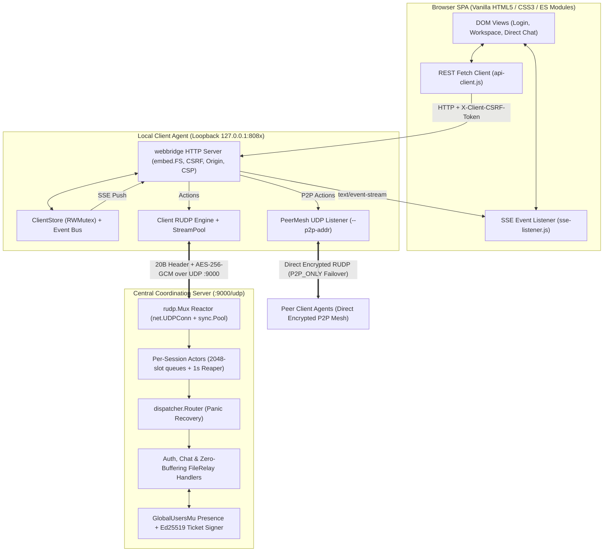
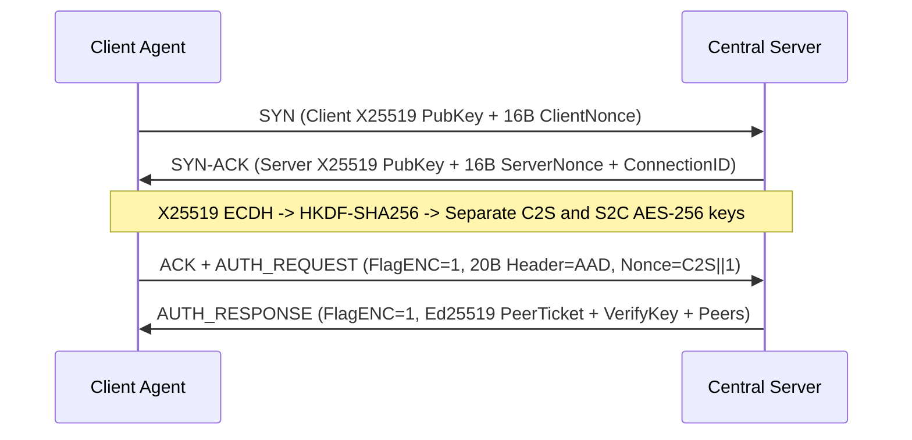
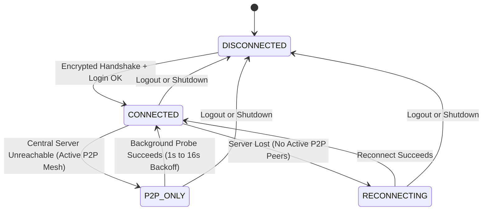
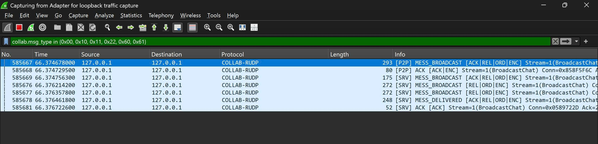

<div align="center">

# Network Streaming Collaboration

**A zero-dependency distributed messaging and SHA-256-verified file-transfer platform built from scratch in pure Go over a custom Reliable UDP (RUDP) transport with QUIC-inspired stream multiplexing, X25519 + AES-256-GCM AEAD encryption, and automatic encrypted P2P failover.**

[](go.mod)
[](go.mod)
[](pkg/transport/rudp)
[](pkg/crypto)
[](docker-compose.yml)
[](LICENSE)

[Highlights](#engineering-highlights) · [Architecture](#system-architecture) · [Protocol](#protocol-specification) · [Security](#security-model) · [P2P Failover](#hybrid-relay-and-p2p-failover) · [Quick Start](#quick-start) · [Wireshark](#wireshark-inspection) · [Benchmarks](#benchmarks-and-testing)

</div>

---

## Engineering Highlights

Instead of relying on high-level transport frameworks (gRPC, WebSocket, or Socket.IO), this project implements the entire transport, cryptographic session layer, multiplexing scheduler, and browser-backed local daemon directly on raw UDP/TCP sockets and the Go 1.22 standard library.

| Area | Design & Implementation |
| --- | --- |
| **Zero-Dependency Full Stack** | [`go.mod`](go.mod) has **0 external modules** (100% Go standard library). The web interface (Vanilla HTML5, CSS3, and ES Modules with zero runtime npm dependencies) is compiled into the client binary via `//go:embed static` ([`web/embed.go`](web/embed.go)). |
| **Custom RUDP Engine** | [`pkg/transport/rudp`](pkg/transport/rudp) implements a single-socket UDP reactor (`rudp.Mux`) backed by `sync.Pool` packet buffers, 4 MiB socket read/write buffers, per-session actor goroutines (`SessionQueueSize = 2048`, `MaxConnections = 128`, 1s reaper / 10s idle timeout), 16-bit SACK `AckBitmap`, Fast Retransmit (`>= 3` SACK bits, `25ms` cooldown), RFC 6298-inspired Jacobson/Karels adaptive RTO (`alpha = 0.125`, `beta = 0.25`, `100ms–3s` bounds, exponential backoff, max 6 retries), `cwnd`/`ssthresh` pacing (`cwnd = 10`, `ssthresh = 64`), and Windows `WSAIoctl` (`SIO_UDP_CONNRESET`) socket hardening ([`socket_windows.go`](pkg/transport/rudp/socket_windows.go)). |
| **QUIC-Inspired Stream Multiplexing** | Separates Control (`0x00`), Broadcast Chat (`0x01`), Direct Chat (`0x02`), and up to **252 concurrent File Transfers** (`0x03–0xFE` via round-robin `StreamPool`) over one physical UDP socket, eliminating Head-of-Line blocking between chat and large binary transfers. |
| **Authenticated Encryption & P2P Trust** | [`pkg/crypto`](pkg/crypto) pairs ephemeral `X25519` ECDH with `HKDF-SHA256` directional session keys (`collab-v1-c2s` / `collab-v1-s2c`), `AES-256-GCM` AEAD authenticating the full 20-byte header as AAD, directional nonces (`C2S\0`/`S2C\0`) with a 64-packet sliding-window anti-replay filter, and server-signed `Ed25519` peer tickets. |
| **Hybrid Relay-to-P2P Failover** | When the central coordination server stops, logged-in clients switch from `CONNECTED` to `P2P_ONLY`, continuing encrypted broadcast chat, direct messaging, and SHA-256-verified chunked file transfers over direct peer UDP sockets while probing the server in the background without clearing history. |
| **Observability & Fault Injection** | Ships an outbound UDP impairment emulator ([`NetEmConn`](pkg/transport/rudp/netem.go): `--loss`, `--reorder`, `--duplicate`, `--corrupt`, `--delay`, `--jitter`) and a Wireshark Lua dissector ([`scripts/wireshark/collab_rudp.lua`](scripts/wireshark/collab_rudp.lua)) exposing `collab.*` display filters and `[SRV]`/`[P2P]` annotations. |

---

## System Architecture

Each participant runs a self-contained **Client Agent** that serves the embedded browser UI over loopback HTTP (`REST` + `Server-Sent Events`), maintains thread-safe local state, and drives both the encrypted server RUDP session and a direct **PeerMesh** UDP listener for server-less P2P failover.



---

## Protocol Specification

Every datagram on the wire begins with a fixed **20-byte Big-Endian RUDP header** ([`pkg/protocol/header.go`](pkg/protocol/header.go)) followed by a bounded payload (`MaxUDPPayload = 1380` bytes) sized to avoid IP fragmentation.

```text
 0                   1                   2                   3
 0 1 2 3 4 5 6 7 8 9 0 1 2 3 4 5 6 7 8 9 0 1 2 3 4 5 6 7 8 9 0 1
+-+-+-+-+-+-+-+-+-+-+-+-+-+-+-+-+-+-+-+-+-+-+-+-+-+-+-+-+-+-+-+-+
| Version (0x01)|     Flags     |    MsgType    |   StreamID    |
+-+-+-+-+-+-+-+-+-+-+-+-+-+-+-+-+-+-+-+-+-+-+-+-+-+-+-+-+-+-+-+-+
|                         ConnectionID                          |
+-+-+-+-+-+-+-+-+-+-+-+-+-+-+-+-+-+-+-+-+-+-+-+-+-+-+-+-+-+-+-+-+
|                            SeqNum                             |
+-+-+-+-+-+-+-+-+-+-+-+-+-+-+-+-+-+-+-+-+-+-+-+-+-+-+-+-+-+-+-+-+
|                            AckNum                             |
+-+-+-+-+-+-+-+-+-+-+-+-+-+-+-+-+-+-+-+-+-+-+-+-+-+-+-+-+-+-+-+-+
|           AckBitmap           |          WindowSize           |
+-+-+-+-+-+-+-+-+-+-+-+-+-+-+-+-+-+-+-+-+-+-+-+-+-+-+-+-+-+-+-+-+
|   Payload (<= 1380 B; if FlagENC: 12B Nonce || CT || 16B Tag) |
+-+-+-+-+-+-+-+-+-+-+-+-+-+-+-+-+-+-+-+-+-+-+-+-+-+-+-+-+-+-+-+-+
```

### Wire Flags & Stream Multiplexing

- **Header Flags (`Flags`)**: `SYN (0x01)` · `ACK (0x02)` · `FIN (0x04)` · `RST (0x08)` · `REL (0x10)` · `ORD (0x20)` · `FRAG (0x40)` · `ENC (0x80)`
- **Flow Control & SACK**: `AckNum` carries the next expected sequence number (cumulative ACK), `AckBitmap` encodes selective reception for `[AckNum + 1 .. AckNum + 16]`, and `WindowSize` advertises receiver capacity (default `64`). Receiving `>= 3` set bits in `AckBitmap` triggers immediate Fast Retransmit for the missing segment.

| `StreamID` | Channel | Ordering & Delivery Semantics |
| --- | --- | --- |
| `0x00` | **Control** | Handshake, authentication, peer discovery, heartbeat (`PING`/`PONG`), error frames, and P2P control. |
| `0x01` | **Broadcast Chat** | Ordered room messages (`MESS_BROADCAST`) and delivery acknowledgements. |
| `0x02` | **Direct Chat** | Ordered 1-to-1 messages (`MESS_UNICAST`) and delivery acknowledgements (`MESS_DELIVERED`). |
| `0x03–0xFE` | **File Transfers** | Up to 252 isolated streams allocated round-robin via `StreamPool`. Each `FILE_CHUNK` prepends a 24-byte binary sub-header (`16B TransferID \| 4B ChunkIndex \| 4B DataLen`) and carries up to `1200 B` of data with deterministic `SeqNum = ChunkIndex + 1`. The server relays chunks directly to recipient queues without buffering files in RAM or on disk, and the receiver verifies full-file `SHA-256` before promoting from `staging/` to `downloads/`. |

<details>
<summary>View all 24 wire message types (0x00–0x62)</summary>

| Code | Constant | Category | Description |
| --- | --- | --- | --- |
| `0x00` | `CTRL_HANDSHAKE` | Control | 3-way RUDP handshake & X25519 key exchange |
| `0x10` | `AUTH_REQUEST` | Auth | Encrypted login request with client P2P port |
| `0x11` | `AUTH_RESPONSE` | Auth | Auth result, signed `PeerTicket`, verify key & online peers |
| `0x12` | `LOGOUT` | Auth | Graceful session termination request |
| `0x13` | `LOGOUT_RESPONSE` | Auth | Server logout confirmation |
| `0x20` | `DISCO_PEERS` | Discovery | Request fresh online peer snapshot |
| `0x21` | `DISCO_PEERS_RESPONSE` | Discovery | Current online peer list |
| `0x22` | `DISCO_UPDATE` | Discovery | Encrypted real-time presence update broadcast |
| `0x30` | `MESS_BROADCAST` | Chat | Room-wide broadcast message |
| `0x31` | `MESS_UNICAST` | Chat | Direct peer-to-peer or relayed message |
| `0x32` | `MESS_DELIVERED` | Chat | End-to-end message delivery receipt |
| `0x40` | `FILE_INIT` | File | Transfer metadata (`TransferID`, size, chunk count, SHA-256) |
| `0x41` | `FILE_RESPONSE` | File | Receiver acceptance or rejection |
| `0x42` | `FILE_CHUNK` | File | 24B binary sub-header + up to 1200B payload chunk |
| `0x43` | `FILE_COMPLETE` | File | Transfer completion & verification signal |
| `0x44` | `FILE_CANCEL` | File | Sender or receiver transfer cancellation |
| `0x50` | `ACK` | Transport | Standalone cumulative + 16-bit SACK acknowledgement |
| `0x51` | `PING` | Transport | Keepalive probe |
| `0x52` | `PONG` | Transport | Keepalive response |
| `0x53` | `WINDOW_UPDATE` | Transport | Flow-control receive window update |
| `0x54` | `ERROR` | Transport | Recoverable/fatal protocol error payload |
| `0x60` | `PEER_HELLO` | P2P | Direct peer identity & Ed25519 ticket presentation |
| `0x61` | `PEER_HELLO_ACK` | P2P | Verified direct peer link acknowledgement |
| `0x62` | `PEER_BYE` | P2P | Intentional direct peer disconnect |

</details>

---

## Security Model

Transport security is enforced at the wire protocol boundary rather than delegated to external TLS termination, while the local web interface enforces strict browser-isolation controls.



| Layer | Security Controls Implemented |
| --- | --- |
| **Wire & Cryptographic Layer** | Ephemeral `X25519` key agreement + `HKDF-SHA256` directional keys (`collab-v1-c2s` / `collab-v1-s2c` bound to `ConnectionID` and both nonces); `AES-256-GCM` authenticating the full 20-byte header as AAD; directional 12-byte nonces (`C2S\0`/`S2C\0` + atomic 64-bit counter); 64-packet sliding-window anti-replay check; constant-time credential comparison (`subtle.ConstantTimeCompare`); encrypted `DISCO_UPDATE` frames (plaintext rejected). |
| **P2P Identity Trust** | Server generates an ephemeral `Ed25519` keypair on startup and issues signed peer tickets over `username\|ip\|p2pPort\|loginAt`. Peers validate each other's ticket using the server's verify key during `PEER_HELLO` / `PEER_HELLO_ACK` before activating direct messaging or file transfer. |
| **Local HTTP UI Bridge** | [`internal/client/webbridge`](internal/client/webbridge) restricts Host/Origin headers to `127.0.0.1` / `localhost`, enforces constant-time `X-Client-CSRF-Token` validation on all mutating `/api/v1/*` routes, sets strict `Content-Security-Policy` (`default-src 'self'; script-src 'self'; frame-ancestors 'none'`), `X-Content-Type-Options: nosniff`, `Referrer-Policy: no-referrer`, caps uploads (`1 GiB` default), and strips directory traversal sequences via [`SanitizeFileName`](internal/client/transfer/sanitizer.go). |

---

## Hybrid Relay and P2P Failover

Each client binds a dedicated peer UDP listener (`--p2p-addr`) alongside its server socket and eagerly builds encrypted direct links to online peers using deterministic lexicographic tie-breaking (`localUser < remoteUser`).



- **Zero History Loss**: When the central server is stopped (`Ctrl+C`), active clients transition to `P2P_ONLY`, keeping existing messages, peer presence, and active file transfers alive over direct encrypted UDP sessions while `ReconnectManager` probes the server in the background (`1s` initial, `2x` multiplier up to `16s`).
- **Topology Scope**: Direct failover operates across directly routable peer UDP endpoints (loopback, LAN, or Docker bridge networks). NAT traversal (STUN/TURN) is outside the current scope.

---

## Quick Start

**Requirements:** Go `1.22+` (or Docker Engine with Compose v2) and a modern web browser. Run all commands from the repository root (the directory containing [`go.mod`](go.mod)).

### Option A — Docker Compose (1 Server + 3 Client Agents)

Launch the full multi-client topology on an isolated bridge network (`mmt-network`) with a single command:

```powershell
docker compose up --build -d
```

| Container | Role | Browser UI | Host Storage Volume | Demo Credentials |
| --- | --- | --- | --- | --- |
| `mmt-server` | Central RUDP Server (`:9000/udp`) | — | `configs/users.json` (read-only) | — |
| `mmt-client-1` | Client Agent 1 | `http://127.0.0.1:8081` | `./storage/client1` | `hung.vo` / `Password@123` |
| `mmt-client-2` | Client Agent 2 | `http://127.0.0.1:8082` | `./storage/client2` | `Alice` / `Alice@123` |
| `mmt-client-3` | Client Agent 3 | `http://127.0.0.1:8083` | `./storage/client3` | `Bob` / `Bob@123` |

```powershell
docker compose logs -f   # Stream container logs
docker compose down      # Stop and remove containers
```

### Option B — Native Go (Multi-Terminal + Live P2P Failover Demo)

1. **Verify Go and build both binaries:**

   ```powershell
   go version
   go build ./cmd/server ./cmd/client
   ```

2. **Start the central server and 3 client agents in separate terminals** (fixed `--p2p-addr` ports keep peers directly reachable after the server stops):

   | Terminal | Command | Browser URL | Demo User |
   | --- | --- | --- | --- |
   | **1 — Server** | `go run ./cmd/server --mode full --addr 127.0.0.1:9000 --users configs/users.json` | — | — |
   | **2 — Client 1** | `go run ./cmd/client --mode ui --server 127.0.0.1:9000 --ui-port 8081 --p2p-addr 127.0.0.1:9101 --storage storage/client1` | `http://127.0.0.1:8081` | `hung.vo` |
   | **3 — Client 2** | `go run ./cmd/client --mode ui --server 127.0.0.1:9000 --ui-port 8082 --p2p-addr 127.0.0.1:9102 --storage storage/client2` | `http://127.0.0.1:8082` | `Alice` |
   | **4 — Client 3** | `go run ./cmd/client --mode ui --server 127.0.0.1:9000 --ui-port 8083 --p2p-addr 127.0.0.1:9103 --storage storage/client3` | `http://127.0.0.1:8083` | `Bob` |

3. **Exercise the system & test failover:**
   - Open each browser URL in a separate window and sign in with that row's demo account (each account enforces a single active session).
   - Send broadcast room messages, 1-to-1 direct messages, and file transfers (default limit `1 GiB`; staging files live in `<storage>/staging` and verified files in `<storage>/downloads`).
   - Once peers discover each other, press **Ctrl+C** in Terminal 1 (Server): every UI switches to `P2P_ONLY` and continues chat and file transfers directly. Restart Terminal 1 to resume server-assisted discovery.
   - Verify SHA-256 integrity of a downloaded file (note that downloads may append a prefix/suffix to prevent collisions; compare against the saved path shown in the UI):

   ```powershell
   Get-FileHash .\sample.bin -Algorithm SHA256
   Get-FileHash .\storage\client2\downloads\sample.bin -Algorithm SHA256
   ```

   > When shutting down normally, stop client agents with **Ctrl+C** before stopping the server so each client can send its `LOGOUT` request.

---

## Wireshark Inspection

The custom Lua dissector at [`scripts/wireshark/collab_rudp.lua`](scripts/wireshark/collab_rudp.lua) decodes the 20-byte RUDP header, registers the `collab.*` display-filter namespace, tags packets as `[SRV]` or `[P2P]` in the **Info** column, and exposes AES-256-GCM wire metadata (`collab.nonce.dir`, `collab.nonce.counter`, `collab.ciphertext`, `collab.gcm_tag`) while keeping encrypted payloads opaque. It binds UDP port `9000` and ports `9101–9105`, and uses a UDP heuristic to detect ephemeral P2P ports.



### Installing the Dissector

1. In Wireshark, open **Help -> About Wireshark -> Folders** and locate **Personal Lua Plugins**.
2. Copy [`scripts/wireshark/collab_rudp.lua`](scripts/wireshark/collab_rudp.lua) into that folder (create it if needed).
3. Ensure Lua support is enabled under **Edit -> Preferences -> Lua**, then restart Wireshark.
4. Capture on the loopback adapter (`Adapter for loopback traffic capture` on Windows, `lo` on Linux). If a packet is not decoded automatically, right-click it and select **Decode As... -> UDP -> COLLAB-RUDP**.

<details>
<summary>Useful Wireshark display filters (10 presets)</summary>

Paste any expression below into Wireshark's display-filter bar:

| Inspection Target | Display Filter |
| --- | --- |
| All Collab RUDP packets | `collab_rudp` |
| Exclude keepalive `PING`/`PONG` | `collab_rudp && !(collab.msg_type in {0x51, 0x52})` |
| P2P traffic only (exclude `:9000` & keepalives) | `collab_rudp && !(udp.port == 9000) && !(collab.msg_type in {0x51, 0x52})` |
| Login & peer handshake | `collab.msg_type in {0x00, 0x10, 0x11, 0x22, 0x60, 0x61}` |
| Broadcast chat (including stream control) | `collab.stream_id == 1 || collab.msg_type == 0x30` |
| Direct chat (including stream control) | `collab.stream_id == 2 || collab.msg_type == 0x31` |
| File transfers & chunks | `collab.stream_id >= 3 || collab.msg_type in {0x40..0x44}` |
| File setup & completion only | `collab.msg_type in {0x40, 0x41, 0x43, 0x44}` |
| Encrypted packets (`FlagENC`) | `collab.flags.enc == 1` |
| Reliable / retransmission packets (`FlagREL`) | `collab.flags.rel == 1` |

> Chat and file filters match both stream IDs and message types; filter strictly on `collab.msg_type == 0x30` to isolate only broadcast message frames.

</details>

---

## Built-in Network Simulation

Both `server` and `client` binaries include an outbound UDP impairment emulator ([`pkg/transport/rudp/netem.go`](pkg/transport/rudp/netem.go)) that validates rates (`0..1`) and non-negative Go durations before opening sockets.

```powershell
# Simulate 10% outbound packet loss and up to 30ms random jitter on Client 3
go run ./cmd/client --mode ui --server 127.0.0.1:9000 --ui-port 8083 --storage storage/client3 --loss 0.10 --jitter 30ms
```

In Docker Compose, append flags directly to the service's `command:` list in [`docker-compose.yml`](docker-compose.yml) (these are CLI flags, not environment variables) and recreate that container:

```yaml
      - --loss=0.05
      - --jitter=30ms
```

```powershell
docker compose up --build -d mmt-client-2
```

> Flags impair **outbound** traffic from the configured process only; set them on both client and server to model bidirectional link degradation. `--delay` adds a fixed base delay while `--jitter` adds uniform random delay in `[0, jitter]`. Start with low `--loss` and `--corrupt` rates so handshakes can complete.

<details>
<summary>All 6 impairment flags and suggested test profiles</summary>

| Flag | Behavior | Suggested Values & Example Conditions |
| --- | --- | --- |
| `--loss` | Drops outbound datagrams randomly. | `0`: none · `0.001–<0.01`: occasional Wi-Fi loss · `0.01–<0.05`: congested Wi-Fi/mobile · `0.05–0.15`: poor edge link · `>0.15`: severe stress (`1` drops all). |
| `--reorder` | Delays selected datagrams so later packets arrive first. | `0`: none · `0.001–<0.01`: occasional reordering · `0.01–<0.05`: unstable route · `>=0.05`: severe reordering stress. |
| `--duplicate` | Sends a second copy of selected outbound datagrams. | `0`: none · `0.001–<0.01`: rare duplicates · `0.01–<0.05`: noticeable duplication · `>=0.05`: stress test. |
| `--corrupt` | Flips a bit in selected outbound datagrams to exercise AEAD/checksum rejection. | `0`: none · `0.001–<0.01`: rare corruption · `0.01–<0.05`: frequent integrity failures · `>=0.05`: fault-injection stress. |
| `--delay` | Adds a fixed one-way delay to every outbound packet. | `0ms`: none · `1–<20ms`: nearby LAN · `20–<80ms`: regional WAN · `80–150ms`: distant/congested path · `>150ms`: high-latency stress. |
| `--jitter` | Adds uniform random delay `0..jitter` per outbound packet. | `0ms`: steady · `1–<10ms`: good broadband · `10–<30ms`: variable Wi-Fi · `30–<80ms`: congested link · `80–150ms`: highly variable path · `>150ms`: extreme jitter. |

</details>

---

## Benchmarks and Testing

The repository comprises **111 Go source files**, including **49 test files** and **109 test, fuzz, and benchmark functions** covering protocol marshaling, RUDP stream reordering/SACK/RTO, concurrent handshakes, large-file relay, malformed-packet fuzzing, AES-GCM/replay security, HTTP/SSE bridge invariants, and P2P server failover, alongside Node.js browser state tests ([`web/static/js/store.test.mjs`](web/static/js/store.test.mjs)).

### Cryptographic Microbenchmarks

Measured via `go test "-bench=." -benchmem -run=NONE ./pkg/crypto` (`Windows/amd64`, `13th Gen Intel(R) Core(TM) i5-1340P`):

| Benchmark | Time / op | Throughput | Memory / op | Allocations / op |
| --- | --- | --- | --- | --- |
| `BenchmarkX25519DeriveSessionKeys` | `63.1 µs` (`63,102 ns`) | — | `1,856 B` | `30 allocs` |
| `BenchmarkAESGCMEncryptPacket1KB` | `1.23 µs` (`1,228 ns`) | `833.71 MB/s` | `1,192 B` | `3 allocs` |
| `BenchmarkAESGCMDecryptPacket1KB` *(encrypt + decrypt + replay check)* | `2.64 µs` (`2,639 ns`) | `388.00 MB/s` | `2,264 B` | `5 allocs` |

### Running Checks

```powershell
# Run Go unit and integration suites
go test ./...

# Run static analysis and Go race detector
go vet ./...
go test -race ./...

# Run crypto benchmarks (quote -bench=. in PowerShell)
go test "-bench=." -benchmem -run=NONE ./pkg/crypto

# Run embedded frontend state tests (requires Node.js)
node --test web/static/js/*.test.mjs
```

> On Linux, macOS, or WSL, [`Makefile`](Makefile) also provides convenience targets (`make check`, `make test-rudp`, `make test-int`, `make cover`).

---

## Project Structure

```text
.
├── cmd/
│   ├── server/                 # Central RUDP coordination server entrypoint
│   └── client/                 # Local client agent & HTTP UI entrypoint
├── pkg/
│   ├── protocol/               # 20B Big-Endian header, 24 message codecs, 24B chunk sub-header
│   ├── crypto/                 # X25519 ECDH, HKDF-SHA256, AES-256-GCM AEAD + 64-pkt anti-replay
│   └── transport/
│       ├── rudp/               # Mux reactor, StreamPool, SACK/Fast Retransmit, Adaptive RTO, NetEm, Windows WSAIoctl
│       └── tcp_handshake/      # Baseline TCP handshake milestone
├── internal/
│   ├── server/                 # ServerApp, panic-safe Router, Auth/Chat/FileRelay handlers, GlobalUsersMu state
│   └── client/                 # ClientApp, PeerMesh P2P failover, ReconnectManager, SHA-256 transfer, webbridge HTTP/SSE
├── web/                        # //go:embed Vanilla HTML5 / CSS3 / ES Modules SPA + store.test.mjs
├── scripts/wireshark/          # Wireshark Lua dissector (collab_rudp.lua)
├── tests/integration/          # End-to-end, concurrency, large-file, fuzzing, security & P2P failover suites
├── configs/                    # Local demo credential configuration (users.json)
├── docs/images/                # Wireshark dissector screenshot
├── Dockerfile                  # Multi-stage Go 1.22 -> Alpine 3.20 runtime image
├── docker-compose.yml          # 1-server + 3-client local topology
└── Makefile                    # Test, race, coverage, and milestone smoke targets
```

---

## Reference and Operations

<details>
<summary><strong>CLI Configuration Reference (Server & Client Flags)</strong></summary>

#### Server (`./cmd/server`)

| Flag | Default | Description |
| --- | --- | --- |
| `--mode` | `full` | Server mode (`full` runs the encrypted RUDP backend for the UI; also supports `step2-tcp`, `rudp`, `step3-auth` through `step9-http-ui`). |
| `--addr` | `:9000` | UDP (or `step2-tcp`) listen address. |
| `--users` | `configs/users.json` | Path to JSON credential store. |
| `--log-level` | `info` | Accepted for compatibility; uses Go's default logger configuration. |

#### Client (`./cmd/client`)

| Flag | Default | Description |
| --- | --- | --- |
| `--mode` | `ui` | Client mode (`ui` is an alias for `step9-http-ui`; also supports `step2-tcp` through `step9-http-ui`). |
| `--server` | `127.0.0.1:9000` | Central server address. |
| `--ui-addr` | `127.0.0.1:8081` | Local HTTP UI listen address (keep on loopback for local browser access). |
| `--ui-port` | `0` | Loopback port alias (for example `8082` binds `127.0.0.1:8082`). Must be unique per running client. |
| `--storage-dir` | `storage` | Per-client root directory for `staging/` and `downloads/`. |
| `--storage` | `""` | Alias for `--storage-dir` (passing conflicting non-default paths exits with an error). |
| `--p2p-addr` | `0.0.0.0:0` | Direct peer UDP listener address (`:0` selects an ephemeral port). |
| `--max-upload-bytes` | `1073741824` | Maximum browser upload size in bytes (`1 GiB`). |

</details>

<details>
<summary><strong>Local HTTP UI Bridge API (REST & SSE)</strong></summary>

All mutating endpoints under `/api/v1/*` require the process-local `X-Client-CSRF-Token` header returned by `GET /api/v1/session`.

| Method & Route | Purpose |
| --- | --- |
| `GET /` | Serves the embedded single-page application (`index.html`). |
| `GET /api/v1/session` | Returns bootstrap state, connection mode, messages, transfers, and `CSRFToken`. |
| `POST /api/v1/auth/login` | Performs encrypted UDP handshake + server authentication. |
| `POST /api/v1/auth/logout` | Logs out and tears down server and P2P sessions. |
| `GET /api/v1/peers` | Returns the current online peer snapshot. |
| `POST /api/v1/peers/refresh` | Requests a fresh peer list from the server (or returns `P2P_ONLY` cache). |
| `POST /api/v1/messages/broadcast` | Queues an encrypted broadcast chat message. |
| `POST /api/v1/messages/unicast` | Queues an encrypted direct message (relayed or direct P2P). |
| `GET /api/v1/events` | Streams real-time chat, presence, connection-state, and file events via SSE. |
| `POST /api/v1/files/send` | Streams a multipart upload to client staging and initiates chunked transfer. |
| `POST /api/v1/files/{transfer_id}/cancel` | Cancels an active file transfer. |
| `POST /api/v1/files/{transfer_id}/retry` | Retries an interrupted or failed file transfer. |
| `GET /api/v1/files/{transfer_id}/download` | Streams a completed, SHA-256-verified file from `downloads/`. |

</details>

<details>
<summary><strong>Troubleshooting</strong></summary>

- **Address already in use**: Choose another server UDP port or client `--ui-port` / `--p2p-addr`. Update `--server` on every client if the server port changes.
- **Cannot connect / `ERR_SERVER_UNREACHABLE`**: Confirm the server terminal is running, `--server` matches its listen address/port, and local firewall rules permit UDP traffic.
- **The UI does not open**: Verify the HTTP address printed by the client agent on startup and confirm no other process holds that port (`http://127.0.0.1:808x`).
- **Login reports account already online**: Sign out from the active window or choose a different demo account.
- **A peer is missing**: Click refresh in the peer list and confirm both client agents completed login.
- **File upload is rejected**: Check `--max-upload-bytes` and available disk space in that client's `--storage-dir`.

</details>

<details>
<summary><strong>Demo Accounts & Security Notice</strong></summary>

The local credential file ([`configs/users.json`](configs/users.json)) provisions five demo accounts for local evaluation:

| Username | Password |
| --- | --- |
| `hung.vo` | `Password@123` |
| `Alice` | `Alice@123` |
| `Bob` | `Bob@123` |
| `Charlie` | `Charlie@123` |
| `David` | `David@123` |

> **Security Notice:** These credentials are for local demonstration and testing only. Replace them before running outside a trusted development environment.

</details>

---

## License

Released under the [MIT License](LICENSE).
